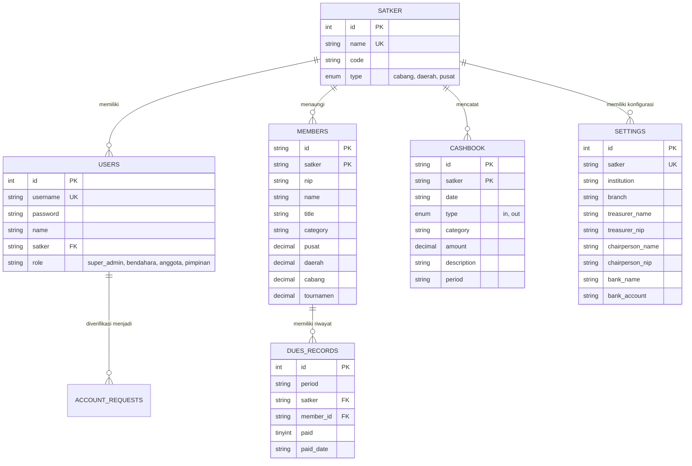

# 🎾 PTWP-Hub (Sistem Informasi, Rekapitulasi Iuran & Perbendaharaan Kas PTWP)

[](https://nextjs.org/)
[](https://react.dev/)
[](https://www.mysql.com/)
[](https://github.com/exceljs/exceljs)
[](https://sheetjs.com/)
[](https://fonts.google.com/)

> **Aplikasi Sistem Informasi Terpadu Pengelolaan Iuran, Kas, Turnamen, dan Monitoring Multi-Satker PTWP (Persatuan Tenis Warga Peradilan) Mahkamah Agung Republik Indonesia.**  
> Dirancang responsif (*mobile-first & desktop-optimized*) dengan arsitektur hybrid (*Next.js App Router + MySQL Backend + Offline-First Local Cache*) serta integrasi Ekspor/Impor Microsoft Excel otomatis sesuai standar resmi kedinasan peradilan.

---

## 📌 Daftar Isi
1. [Tentang Sistem & Latar Belakang](#-tentang-sistem--latar-belakang)
2. [Arsitektur Sistem & Teknologi](#-arsitektur-sistem--teknologi)
3. [Fitur-Fitur Utama Aplikasi](#-fitur-fitur-utama-aplikasi)
4. [Skema & Struktur Basis Data (MySQL)](#-skema--struktur-basis-data-mysql)
5. [Spesifikasi Format Excel Resmi (Export/Import)](#-spesifikasi-format-excel-resmi-exportimport)
6. [Struktur Data & Standar Tarif Iuran](#-struktur-data--standar-tarif-iuran)
7. [Struktur Direktori Proyek](#-struktur-direktori-proyek)
8. [Panduan Instalasi & Konfigurasi](#-panduan-instalasi--konfigurasi)
9. [Akun Pengujian Bawaan (Default Credentials)](#-akun-pengujian-bawaan-default-credentials)
10. [Konsep Desain UI/UX](#-konsep-desain-uiux)
11. [Ketahanan Sistem & Penanganan Error](#-ketahanan-sistem--penanganan-error)
12. [Lisensi & Penutup](#-lisensi--penutup)

---

## 🎯 Tentang Sistem & Latar Belakang

**PTWP (Persatuan Tenis Warga Peradilan)** adalah organisasi olahraga resmi di lingkungan Mahkamah Agung Republik Indonesia dan 4 (empat) lingkungan peradilan di bawahnya. 

Dalam operasional perbendaharaan pada satuan kerja tingkat cabang maupun daerah (**Pengadilan Agama Gunung Sugih** serta **Pengadilan Tinggi Agama Bandar Lampung** membawahi 14 satuan kerja cabang se-Provinsi Lampung), bendahara menghadapi tantangan:
- **Rekapitulasi Rutin 4 Pos Iuran**: Mengelola iuran bulanan yang terbagi atas **Iuran Pusat**, **Iuran Daerah**, **Iuran Cabang**, dan **Iuran Tournamen** dari puluhan aparatur peradilan lintas jabatan (Ketua, Wakil Ketua, Hakim, Panitera, Sekretaris, Pejabat Struktural/Fungsional, Jurusita, hingga PPNPN).
- **Format Laporan Fisik Kedinasan**: Kebutuhan dokumen pertanggungjawaban dalam bentuk berkas Microsoft Excel (.xlsx) dengan tata letak baku, formula dinamis, dan blok pengesahan tanda tangan Bendahara & Ketua Cabang.
- **Monitoring Multi-Satker Terpusat**: Pengurus Daerah (PTA) membutuhkan pengawasan kepatuhan setoran iuran dan mutasi kas dari 14 satuan kerja Pengadilan Agama cabang secara *real-time*.
- **Pencatatan Perbendaharaan Kas Transparan**: Pengelolaan pemasukan iuran rutin, donasi/sponsor, serta pengeluaran operasional (sewa lapangan tenis, pengadaan bola, konsumsi latihan, serta kontingen turnamen KPTA Cup / MA Cup).

**PTWP-Hub** hadir sebagai solusi sistem informasi modern untuk mendigitalkan, mengintegrasikan, dan mengotomatisasi seluruh siklus tata kelola perbendaharaan PTWP secara akuntabel, cepat, dan mudah diakses dari smartphone maupun PC kantor.

---

## 🛠️ Arsitektur Sistem & Teknologi

PTWP-Hub dibangun dengan arsitektur **Hybrid Dual-Engine** yang menjamin aplikasi tetap berkinerja tinggi, responsif, dan tahan terhadap gangguan koneksi:

```
┌─────────────────────────────────────────────────────────────┐
│                       Client Layer                          │
│   Next.js 14 (React 18) SPA • Google Stitch Design Tokens   │
│   Desktop Smart Table View • Mobile Adaptive Card View      │
└──────────────┬──────────────────────────────┬───────────────┘
               │                              │
     (Local Cache / Offline-First)    (REST API Fetch / JSON)
               │                              │
               ▼                              ▼
┌─────────────────────────────┐  ┌────────────────────────────┐
│   Browser Local Storage     │  │   Next.js App Router API   │
│  - Instant UI Response      │  │  - /api/dues               │
│  - Offline Session Data     │  │  - /api/cashbook           │
│  - Fallback Redundancy      │  │  - /api/users & /api/auth  │
└─────────────────────────────┘  │  - /api/satker & /settings │
                                 └──────────────┬─────────────┘
                                                │ (mysql2 pool)
                                                ▼
                                 ┌────────────────────────────┐
                                 │     MySQL Database Engine  │
                                 │      `db_ptwp` (Laragon)   │
                                 │  - Multi-tenant Satker     │
                                 │  - Composite Primary Keys  │
                                 │  - Audit Timestamp Logs    │
                                 └────────────────────────────┘
```

- **Framework**: [Next.js 14 (App Router)](https://nextjs.org/) — Menghadirkan performa render kilat, arsitektur modular, dan API routes terpadu.
- **UI Engine**: React 18, [Lucide React](https://lucide.dev/) Icons, dan sistem styling murni berbasis CSS Variables & Google Stitch Design Tokens (tanpa framework bloatware).
- **Database Engine**: [MySQL](https://www.mysql.com/) menggunakan driver `mysql2` dengan connection pooling.
- **Excel Generation**: [ExcelJS](https://github.com/exceljs/exceljs) — Menghasilkan file Excel fisik murni dengan border ganda, warna identitas peradilan `#0F5132`, font formal, merge cells, formula kalkulasi dinamis `=SUM(...)`, dan lembar pengesahan resmi.
- **Excel Parser**: [SheetJS (xlsx)](https://sheetjs.com/) — Memproses lembar kerja buku kas tahunan/bulanan, membaca multi-sheet otomatis (Januari–Desember), dan melakukan validasi sanitasi data sebelum disimpan.

---

## ⚡ Fitur-Fitur Utama Aplikasi

### 1. 📊 Modul Rekapitulasi Iuran (Core Engine)
- **Kalkulasi Otomatis Presisi**: Nominal per pos iuran (*Pusat, Daerah, Cabang, Tournamen*) dan total per baris pegawai dihitung otomatis secara *real-time*.
- **Pencatatan Status Lunas Instan**: Klik status bayar pegawai langsung memperbarui status pelunasan dan otomatis terhubung ke jurnal kas masuk.
- **Navigasi Multi-Bulan & Multi-Tahun**: Pengelolaan data arsip iuran antar-bulan tanpa risiko tertimpa, dilengkapi indikator badge *Ada Data*.
- **Filter Cepat Multi-Kategori**: Filter cepat per unit kerja: *Semua*, *Hakim*, *Kepaniteraan*, *Kesekretariatan*, dan *Staf/PPNPN*.
- **Pencarian Cepat**: Pencarian nama pegawai atau NIP secara instan dengan *debounced filtering*.

### 2. 📥 Modul Ekspor Excel Resmi (.xlsx)
- Menghasilkan file Excel fisik yang identik 100% dengan format laporan dinas Mahkamah Agung:
  - Header ber-merge di tengah (`IURAN PTWP CABANG PENGADILAN AGAMA [NAMA SATKER]`).
  - Baris penanda periode aktif (`Bulan : [Bulan Tahun]`).
  - Format angka akuntansi/Rupiah standar (`#,##0`).
  - Formula dinamis Excel `=SUM(D10:D55)` pada baris TOTAL (bukan angka mati).
  - Lembar tanda tangan resmi di pojok kanan bawah memuat nama & NIP Bendahara serta mengetahui Ketua Cabang PTWP.

### 3. 📤 Modul Impor Excel Cerdas (Multi-Sheet Parser)
- **Auto-Detection Sheet**: Mengenali nama sheet bulan (*Januari, Februari, s/d Desember* atau format penomoran bulan).
- **Auto-Mapping Kolom**: Otomatis mendeteksi kolom No, Nama, Jabatan, Pusat, Daerah, Cabang, dan Turnamen tanpa mengharuskan template kaku.
- **Live Preview Modal**: Pratinjau data interaktif sebelum proses penyimpanan permanen ke basis data.
- **Batch Upsert Processing**: Mampu memproses 12 bulan sekaligus dalam hitungan detik dengan query batch berkecepatan tinggi ke MySQL.

### 4. 💰 Modul Buku Kas Cabang (Cashbook & Mutasi)
- **Integrasi Otomatis Rekap Iuran**: Penerimaan iuran bulanan langsung terkonversi menjadi catatan kas masuk (*debit*) tanpa duplikasi (*auto-id deduping*).
- **Pencatatan Mutasi Fleksibel**: Pencatatan manual kas masuk (sponsor, bantuan satker) dan kas keluar (sewa lapangan tenis, pembelian bola, konsumsi, kontingen lomba).
- **Kalkulasi Saldo Berjalan**: Saldo kas riil dihitung otomatis:  
  $$\text{Saldo Kas} = \sum \text{Kas Masuk} - \sum \text{Kas Keluar}$$

### 5. 🏢 Modul Monitoring Cabang (Khusus Pengurus Daerah / PTA)
- **Pemantauan 15 Satuan Kerja**: Pengurus Daerah PTA Bandar Lampung dapat memantau kepatuhan rekapitulasi iuran dari seluruh Pengadilan Agama se-wilayah Lampung:
  - *PA Gunung Sugih, PA Tanjung Karang, PA Metro, PA Kalianda, PA Tanggamus, PA Pringsewu, PA Gedong Tataan, PA Sukadana, PA Kotabumi, PA Blambangan Umpu, PA Krui, PA Tulang Bawang Tengah, PA Tulang Bawang, PA Mesuji, dan PTA Bandar Lampung*.
- **Indikator Kepatuhan & Persentase**: Menampilkan status keterisian data, jumlah pegawai, persentase kelunasan, dan total himpunan iuran per cabang.
- **Kalender Monitoring Periode**: Dilengkapi indikator titik hijau (*Ada Data*) pada pemilih bulan untuk mengetahui satker yang telah mengirimkan laporan.

### 6. 🏆 Modul Agenda & Turnamen PTWP
- Manajemen agenda turnamen resmi, antara lain:
  - **Turnamen KPTA Cup Lampung** (Tingkat Daerah Se-Wilayah PTA Bandar Lampung).
  - **Turnamen Mahkamah Agung Cup** (Tingkat Nasional Beregu & Perorangan).
  - Pertandingan persahabatan antar-cabang dan latihan gabungan.
- Pencatatan kesiapan kontingen, atlet, dan alokasi dana operasional turnamen.

### 7. 🔐 Modul Autentikasi, Profil & RBAC (Role-Based Access Control)
- **Multi-Level Roles**:
  - `super_admin`: Hak akses absolut konfigurasi sistem, kelola seluruh satker, dan manajemen pengguna.
  - `bendahara`: Akses penuh input iuran, buku kas, ekspor/impor Excel, dan setting dinas satker bersangkutan.
  - `pimpinan`: Akses pemantauan dashboard, laporan kas, dan ekspor dokumen.
  - `anggota`: Akses personal untuk melihat status pembayaran iuran dan transparansi kas cabang.
- **Alur Registrasi & Verifikasi Akun**: Pegawai baru dapat mengajukan akun melalui form registrasi dan disetujui (*Approve/Reject*) oleh Super Administrator pada halaman **Admin View**.
- **Profil Pengguna Interaktif & Logout Aman**: Modal profil menampilkan detail NIP, jabatan, satker, status sesi aktif, serta dialog konfirmasi logout.

### 8. ⚙️ Pengaturan Satker & Pejabat Penandatangan
- Konfigurasi nama satuan kerja, sebutan cabang, nomor rekening dinas Bank Syariah Indonesia (BSI), serta nama dan NIP Ketua & Bendahara dapat diperbarui secara dinamis tanpa mengubah kode program.

---

## 🗄️ Skema & Struktur Basis Data (MySQL)

Aplikasi menggunakan basis data relasional **`db_ptwp`** yang telah dioptimasi dengan arsitektur multi-tenant:



### Rincian Tabel Utama:
1. **`satker`**: Master data 15 satuan kerja peradilan se-wilayah PTA Bandar Lampung.
2. **`users`**: Data otentikasi pengguna, kredensial, role RBAC, dan asosiasi satker.
3. **`account_requests`**: Antrean permohonan pendaftaran akun pengguna baru dari cabang.
4. **`members`**: Data profil aparatur, golongan jabatan, dan besaran tarif 4 pos iuran (Primary Key komposit: `satker` + `id`).
5. **`dues_records`**: Rekam jejak status pelunasan iuran per periode bulan, per satker, per pegawai.
6. **`cashbook`**: Jurnal mutasi kas perbendaharaan cabang (Primary Key komposit: `satker` + `id`).
7. **`settings`**: Konfigurasi nama dinas, nomor rekening kas BSI, nama & NIP pejabat penandatangan resmi.

---

## 📑 Spesifikasi Format Excel Resmi (Export/Import)

Format susunan sel dan kolom yang didukung oleh modul Excel:

| Baris | Kolom A | Kolom B | Kolom C | Kolom D | Kolom E | Kolom F | Kolom G | Kolom H |
| :---: | :--- | :--- | :--- | :--- | :--- | :--- | :--- | :--- |
| **1** | <colspan 8> **IURAN PTWP CABANG PENGADILAN AGAMA GUNUNG SUGIH** | | | | | | | |
| **3** | | **Bulan : September 2026** | | | | | | |
| **5** | **NO** | **N A M A** | **JABATAN** | **IURAN PUSAT** | **IURAN DAERAH** | **IURAN CABANG** | **IURAN TOURNAMEN** | **TOTAL** |
| **10**| 1 | Dr. H. Al Fitri | Ketua | 20.000 | 20.000 | 20.000 | 20.000 | `=SUM(D10:G10)` |
| **11**| 2 | Ibrahim Lubis, S.H.I | Wakil Ketua | 20.000 | 20.000 | 20.000 | 17.500 | `=SUM(D11:G11)` |
| ... | ... | ... | ... | ... | ... | ... | ... | ... |
| **56**| **TOTAL** | | | `=SUM(D10:D55)` | `=SUM(E10:E55)` | `=SUM(F10:F55)` | `=SUM(G10:G55)` | `=SUM(H10:H55)` |
| **58**| | | | | | **Gunung Sugih, September 2026** | | |
| **59**| | | | | | **Bendahara Kantor** | | |
| **64**| | | | | | **Wulan Febrianti, A.Md** | | |

---

## 👥 Struktur Data & Standar Tarif Iuran (PA Gunung Sugih)

| Golongan / Jabatan | Contoh Pejabat | Pusat (Rp) | Daerah (Rp) | Cabang (Rp) | Tour (Rp) | Total (Rp) |
| :--- | :--- | :---: | :---: | :---: | :---: | :---: |
| **Ketua** | Dr. H. Al Fitri | 20.000 | 20.000 | 20.000 | 20.000 | **80.000** |
| **Wakil Ketua** | Ibrahim Lubis, S.H.I., M.H | 20.000 | 20.000 | 20.000 | 17.500 | **77.500** |
| **Hakim** | Ertika Urie / Fitri | 20.000 | 20.000 | 20.000 | 15.000 | **75.000** |
| **Panitera / Sekretaris** | Bustanul Arifin / Aswari | 20.000 | 20.000 | 20.000 | 10.000 | **70.000** |
| **Panmud / Kasub / JabFung** | Novendaria / Ir. Lutfi / Zairi | 15.000 | 15.000 | 15.000 | 7.500 | **52.500** |
| **Panitera Pengganti (PP)** | Tugi / Erlia / Nurhasanah | 10.000 | 10.000 | 10.000 | 4.000 | **34.000** |
| **Jurusita (JS / JSP)** | M. Nur Ardian / Aswan / Finnur | 10.000 | 10.000 | 10.000 | 3.500 | **33.500** |
| **Staf / PPNPN** | Feby / Junisko / Windiyan / Natasya | 5.000 | 5.000 | 5.000 | 1.750 | **16.750** |

---

## 📁 Struktur Direktori Proyek

```text
APP PTWP/
├── src/
│   ├── app/
│   │   ├── api/
│   │   │   ├── auth/route.js          # REST API autentikasi & sesi
│   │   │   ├── cashbook/route.js      # REST API mutasi buku kas cabang
│   │   │   ├── dues/route.js          # REST API rekap iuran & batch import
│   │   │   ├── requests/route.js      # REST API antrean verifikasi akun
│   │   │   ├── satker/route.js        # REST API data master satuan kerja
│   │   │   ├── settings/route.js      # REST API profil satker & penandatangan
│   │   │   ├── status/route.js        # REST API health check server & database
│   │   │   └── users/route.js         # REST API manajemen pengguna & RBAC
│   │   ├── login/
│   │   │   └── page.jsx               # Halaman login mandiri
│   │   ├── error.jsx                  # Custom error boundary halaman (500)
│   │   ├── global-error.jsx           # Global crash error boundary
│   │   ├── not-found.jsx              # Custom 404 page bertema dinas
│   │   ├── globals.css                # CSS variables & Google Stitch design system
│   │   ├── layout.jsx                 # Root layout & metadata aplikasi
│   │   └── page.jsx                   # Single Page Application core manager
│   ├── components/
│   │   ├── AddCashModal.jsx           # Dialog pencatatan transaksi mutasi kas
│   │   ├── AdminView.jsx              # Panel Super Admin verifikasi & kelola user
│   │   ├── AuthModal.jsx              # Dialog login cepat
│   │   ├── AuthView.jsx               # Tampilan login & registrasi akun baru
│   │   ├── CashBookView.jsx           # Modul Buku Kas Cabang & saldo berjalan
│   │   ├── DashboardView.jsx          # Executive Dashboard & grafik penerimaan
│   │   ├── DuesExpenseView.jsx        # Rincian pengeluaran pos iuran
│   │   ├── DuesMobileCards.jsx        # Tampilan kartu iuran smartphone (1-tap)
│   │   ├── DuesTable.jsx              # Smart table rekap iuran desktop 8 kolom
│   │   ├── ExcelExportModal.jsx       # Dialog ekspor berkas Excel berformat dinas
│   │   ├── ExcelImportModal.jsx       # Dialog impor multi-sheet parser & preview
│   │   ├── FeatureLockedModal.jsx     # Dialog proteksi fitur sesuai role
│   │   ├── LockedBlurOverlay.jsx      # Efek blur antarmuka berizin khusus
│   │   ├── MemberFormModal.jsx        # Dialog tambah/ubah anggota & tarif iuran
│   │   ├── MetricCards.jsx            # Kartu ringkasan metrik statistik kas
│   │   ├── MobileBottomNav.jsx        # Navigasi bawah ramah satu tangan di HP
│   │   ├── MonitoringCabangView.jsx   # Dashboard monitoring 14 cabang se-PTA Lampung
│   │   ├── Navbar.jsx                 # Topbar global, kalender periode & profil
│   │   ├── NetworkStatusSentinel.jsx  # Sentinel deteksi status koneksi real-time
│   │   ├── PeriodPickerModal.jsx      # Dialog pemilih bulan dengan indikator data
│   │   ├── SettingsModal.jsx          # Dialog pengaturan satker, bank & penandatangan
│   │   ├── Sidebar.jsx                # Sidebar navigasi desktop interaktif
│   │   ├── TournamentView.jsx         # Modul agenda & turnamen PTWP
│   │   └── UserProfileModal.jsx       # Modal profil akun & dialog konfirmasi logout
│   ├── data/
│   │   └── initialMembers.js          # Master data awal 46 pegawai PA Gunung Sugih
│   ├── lib/
│   │   └── db.js                      # Koneksi database pool MySQL2
│   └── services/
│       ├── excelService.js            # Engine ekspor/impor Excel (ExcelJS & SheetJS)
│       └── storageService.js          # Hybrid repository (LocalStorage + MySQL sync)
├── public/                            # Aset publik, logo, dan favicon
├── .env.local                         # Konfigurasi koneksi MySQL lokal
├── database_ptwp.sql                  # Skema DDL & seed data basis data
├── package.json                       # Konfigurasi dependensi dan skrip proyek
└── README.md                          # Dokumentasi lengkap sistem
```

---

## 🚀 Panduan Instalasi & Konfigurasi

### Persyaratan Sistem:
- **Node.js**: Versi 18.x atau 20.x LTS.
- **NPM**: Versi 9.x atau lebih baru.
- **MySQL / MariaDB**: Server MySQL aktif (melalui Laragon, XAMPP, atau MySQL Server mandiri).

---

### Langkah Instalasi:

#### 1. Clone Repositori
```bash
git clone https://github.com/rofid-c/app-ptwp.git
cd app-ptwp
```

#### 2. Pasang Dependensi Node.js
```bash
npm install
```

#### 3. Siapkan Basis Data MySQL
1. Buka aplikasi **Laragon** atau **phpMyAdmin**.
2. Buat basis data bernama `db_ptwp` atau impor langsung berkas:
   ```bash
   # Jalankan melalui terminal MySQL:
   mysql -u root -p < database_ptwp.sql
   ```
   *(Atau impor `database_ptwp.sql` melalui phpMyAdmin / HeidiSQL).*

#### 4. Konfigurasi Environment (`.env.local`)
Buat atau pastikan berkas `.env.local` berada di direktori utama:
```env
# Konfigurasi Database MySQL (Laragon / XAMPP)
DB_HOST=localhost
DB_PORT=3306
DB_USER=root
DB_PASSWORD=
DB_NAME=db_ptwp
```

#### 5. Jalankan Aplikasi
```bash
npm run dev
```

Aplikasi siap diakses pada:
- **Laptop / PC**: [http://localhost:3000](http://localhost:3000)
- **Smartphone (Jaringan WiFi lokal)**: `http://[IP-Komputer-Anda]:3000` (contoh: `http://192.168.100.223:3000`).

---

## 🔑 Akun Pengujian Bawaan (Default Credentials)

Untuk keperluan pengujian peran (*RBAC*), basis data telah dilengkapi akun bawaan:

| Role / Hak Akses | Username | Password | Satuan Kerja Asal | Keterangan |
| :--- | :--- | :--- | :--- | :--- |
| **Super Admin** | `Aku admin` | `Adminbaik123.com` | Mahkamah Agung RI | Akses penuh seluruh cabang & admin view |
| **Bendahara Cabang** | `user test` | `admin123` | Pengadilan Agama Gunung Sugih | Kelola rekap iuran, kas, dan setting PA GS |
| **Bendahara Daerah** | `bendahara_pta` | `admin123` | PTA Bandar Lampung | Akses menu Monitoring Cabang se-Lampung |
| **Bendahara Cabang Lain**| `bendahara_metro`| `admin123` | Pengadilan Agama Metro | Data terisolasi khusus cabang PA Metro |

---

## 🎨 Konsep Desain UI/UX

1. **Tema Visual Kedinasan (*Judicial Emerald & Tennis Ball Gold*)**:
   - **Warna Utama**: `#0F5132` (Emerald Green Mahkamah Agung) mencerminkan integritas peradilan syar'iyah sekaligus lapangan tenis.
   - **Aksen**: `#EAB308` (Tennis Ball Yellow) memberikan kontras modern untuk indikator status, kartu saldo, dan elemen penting.
2. **Tipografi Modern**:
   - Antarmuka teks menggunakan font Google Fonts **Plus Jakarta Sans**.
   - Angka akuntansi dan nominal mata uang menggunakan **JetBrains Mono** agar presisi dan rapi saat disejajarkan.
3. **Dual Tampilan (Desktop & Mobile First)**:
   - **Desktop**: *Sticky header table*, navigasi sidebar kiri, dan toolbar aksi lengkap.
   - **Mobile**: *Adaptive card view*, aksi toggle 1-tap, dan navigasi bawah (*bottom bar*) yang nyaman digunakan dengan jempol.

---

## 🛡️ Ketahanan Sistem & Penanganan Error

- **Network Status Sentinel**: Indikator real-time yang memantau ketersediaan koneksi internet/jaringan lokal, memastikan data aman tersimpan di cache lokal saat jaringan terputus.
- **Custom Error Boundaries**:
  - `not-found.jsx`: Halaman 404 formal bernuansa dinas dengan tombol kembali ke beranda.
  - `error.jsx` & `global-error.jsx`: Penangkap galat aplikasi (500) dengan opsi reload aman tanpa kehilangan state penting.

---

## 📄 Lisensi & Penutup

Aplikasi dikembangkan untuk mendukung transparansi, akuntabilitas, dan modernisasi tata kelola perbendaharaan pada organisasi **Persatuan Tenis Warga Peradilan (PTWP)** Cabang Pengadilan Agama Gunung Sugih dan Pengurus Daerah se-wilayah Pengadilan Tinggi Agama Bandar Lampung.

© 2026 PTWP Cabang Pengadilan Agama Gunung Sugih. Dikembangkan dengan ❤️ untuk kemajuan olahraga peradilan.
